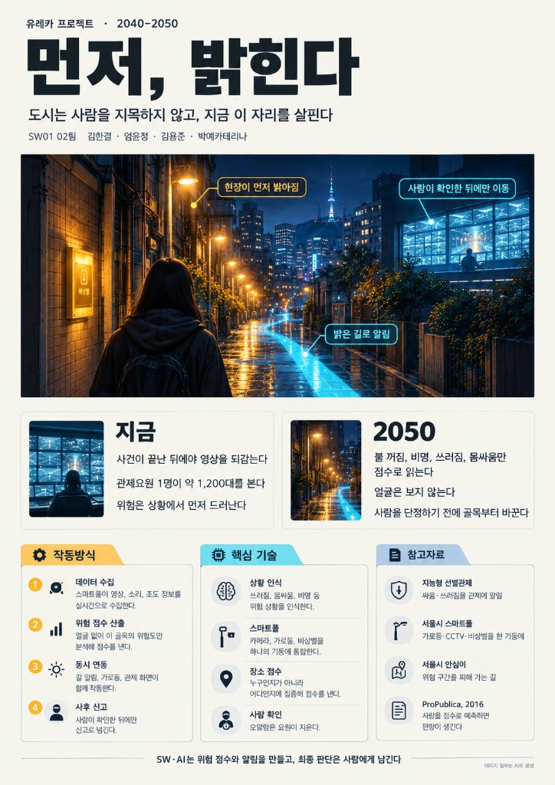

# Welcome to E26-SW01-02

## 🎯 팀 슬로건

> 오늘의 아이디어가 내일의 새로운 기준이 되도록

## 🖼️ 팀 포스터

SW01 02팀, 「먼저, 밝힌다」. 2040–2050년, 사람은 지목하지 않고 골목의 상황을 먼저 밝히는 미래. 이미지 일부는 AI로 생성.

 

## 1️⃣ 팀원 소개

| **이름** | **전공** | **관심사** |
| --- | --- | --- |
| **김한결** | 소프트웨어전공 | 쉐이더 개발 |
| **엄윤정** | 소프트웨어전공 | 베이킹 |
| **김용준** | 소프트웨어전공 | 인공지능, 요리 |
| **박예카테리나** | 소프트웨어전공 | 자전거 타기 |

### 팀 소개

서로 다른 생각을 가지고 있지만, 프로젝트 완성에 대한 기대감이 큰 팀입니다!

 

## 2️⃣ 공통된 관심사 

인공지능 활용

 

## 3️⃣ 한학기 동안의 활동 내역 

- 기관/부서 인터뷰 ✔️  

- 현장 탐방 ✔️  

- 멘토링 ✔️  
  - 내 지도 교수 함게 만나기
  - 대학원 방문 및 선배 만나기

- 프로젝트 진행 ✔️  
  - 과거에 사람들이 상상한 미래
  - 그들이 만들어가는 세상
  - 우리가 상상한 미래
  - 우리가 그리는 미래 그리고 나

- 각오와 소감 나누기 ✔️

 

## 4️⃣ 한학기 동안의 활동 내역 (과제)

### 3주차 — 이정문 화백 사례 4분류

이정문 화백, 「서기 2000년대 생활의 이모저모」(1965) 보고 과거 상상 8개를 나눠봄.

#### Team Mission 1: 4분류

**실현됨**
- 로봇 청소기: 이미 집마다 있음
- 원격 학습: 줌/인강이 그냥 일상
**일부 실현**
- 태양광 주택: 패널은 많은데 집 전체가 자급자족하진 않음
- 전기·자율주행차: 전기차는 흔한데 완전 자율은 아직
- 원격 진료: 비대면은 되지만 아직 제한 많음
**아직 미실현**
- 달나라 수학여행: 민간 우주여행은 시작됐지만 달은 아직이고 너무 비쌈
**방향 전환**
- 소형 TV 전화기: 따로 안 나오고 스마트폰으로 합쳐짐
- 전파 신문: 전파로 안 받고 포털/유튜브로 봄
#### Team Mission 2: Why-What-How (소형 TV 전화기)
- **WHY**: 당시 TV가 귀해서 보고 싶었고, 무전기처럼 들고 다니며 얘기하고 싶었음
- **WHAT**: 손바닥만 한 TV 전화기로 얼굴 보면서 통화하는 일상
- **HOW**: 지금 스마트폰이 그 역할. 전화기+TV가 아니라 컴퓨터+카메라+앱으로 구현됨
- **NEXT**: 중독, 개인정보, 화면 너머 관계 같은 문제가 남음
핵심 질문: 상상은 맞았는데, 구현 방식이 완전히 달라진 거 아닌가?

 

### 5주차 — AI와 함께 문제 다시 쓰기

학교생활에서 직접 겪은 불편함 하나 골라서 AI랑 같이 문제 정의 다시 해봄.

#### Team Mission 1: AI와 함께 문제 다시 쓰기

**Before (관찰된 불편함)**
- 출석체크를 QR로 찍는데, 수업 10분 전 ~ 수업 시작 10분 후까지만 찍혀서 불편함

**AI Questioning (사용한 프롬프트)**
> "QR 출석체크가 수업 시작 10분 전부터 시작 후 10분까지만 인정돼서 불편하다. 이 상황의 핵심 문제와 사용자 요구사항을 추상화하여 다시 정의해줘."

AI 답변 요약
- 핵심 문제: 출석이 '수업에 있었는지'가 아니라 '정해진 20분 안에 QR을 찍었는지'로 판단됨
- 그래서 조금 늦거나 폰 문제로 못 찍으면, 수업을 끝까지 들어도 결석이 될 수 있음
- 사용자 요구: 실제로 수업에 참여했다는 걸 인정받고 싶음 / 지각과 결석을 공정하게 나누고 싶음 / 놓쳤을 때 정정할 방법이 있었으면 함

**검토 (AI 결과 비판적으로 보기)**
- AI가 학생 입장만 봄. 시간 제한은 대리출석이나 늦게 와서 찍고 나가는 걸 막으려는 목적도 있음
- 그래서 "시간 제한을 없애자"가 답이 아니라, 부정 출석은 막으면서 실제 참석은 인정하는 방향이어야 함
- 교수님도 사용자임 (출석 정정 요청 처리하는 쪽)

**After (개선된 문제 정의문)**
- **사용자**: QR로 출석하는 학생 (+ 출석을 관리하는 교수)
- **상황**: 출석 인정 시간이 수업 시작 전후 10분, 총 20분으로 고정되어 있음
- **문제**: 출석이 실제 참석이 아니라 '그 시간에 찍었는지'로만 판단돼서, 조금 늦거나 기기 문제가 생기면 수업을 들어도 결석이 되고, 정정은 따로 요청해야 함
- **기대효과**: 부정 출석은 막으면서 실제 참석 여부로 출석을 인정 → 학생은 억울한 결석이 줄고, 교수는 정정 처리 부담이 줄어듦

핵심 질문: 출석체크는 '찍는 순간'을 확인하는 걸까, '수업에 있었다'는 걸 확인하는 걸까?

 

### 7주차 — AI의 발전으로 해결할 수 있는 사회문제 해결 방안 구체화

**주제: AI 기반 실시간 위험 감지 및 범죄 예방 시스템**

기존 CCTV와 도시 안전시설을 AI로 연결하여 폭행, 위협 행동 등 위험 상황을 빠르게 감지하고, 시민에게 주의 알림과 안전한 이동 경로를 제공하는 미래 서비스를 구상하였다. **사람을 범죄자로 예측하기보다 위험한 상황을 감지하고 실제 예방 행동으로 연결하는 것**을 목표로 한다.

#### Team Mission 1: AI로 위험 상황을 미리 감지하고 예방하기

**1. Before (관찰된 문제)**
- 폭행, 흉기 위협, 심야 골목 습격 등은 초기 대응이 늦어지면 큰 피해로 이어질 수 있다.
- CCTV가 많이 설치되어 있지만 관제요원이 모든 화면을 동시에 살펴보는 것은 어렵다.
- 이미 일부 지역에서 AI CCTV를 활용하고 있지만, 감지 결과를 시민의 안전한 이동이나 주변 환경 개선까지 연결하는 방안은 더 발전시킬 수 있다.

**2. 기존 기술 조사 (실제 활용 사례)**
- **경찰청 Pre-CAS:** 치안·공공데이터를 바탕으로 지역별 범죄위험도를 분석하고, 경찰의 순찰 경로 안내 및 예방활동에 활용하는 시스템이다. 법무부는 2026년 1월 정보 연계 확대 사실을 발표했다.
- **서초구 AI 선별관제:** CCTV 영상에서 배회, 쓰러짐, 침입, 폭행 등 이상행동을 분석해 관제요원에게 알려준다. 2026년 4월에는 카메라 자체에서 영상을 분석하는 엣지형 AI 관제 도입도 발표했다.
- **서울시 현장 사례:** 2025년 12월 종로구에서 지능형 CCTV가 쓰러진 시민을 감지했고, 관제요원의 112 신고 후 현장 조치가 이루어졌다.

**확인한 점:** AI 기반 위험 감지와 순찰 지원은 이미 현실에 도입되고 있다. 따라서 우리 팀은 기술 자체를 처음 개발한다고 주장하기보다, **위험 감지 이후의 보행자 안내·가로등 제어·관제 대응을 통합**하는 방향으로 아이디어를 발전시켰다.

**3. 아이디어**
- CCTV, 비상벨, 가로등 상태 등 여러 안전 정보를 연계해 위험 상황을 감지한다.
- 위험 신호가 포착되면 주변 보행자에게 주의 알림과 안전한 우회 경로를 제공한다.
- 연결된 스마트 가로등의 밝기를 높이고, 가까운 비상벨 위치를 안내한다.
- 관제센터에 관련 화면과 위치를 표시해 관제요원의 확인 및 필요시 경찰 대응을 지원한다.

**4. 검토 (AI 활용의 문제점)**
- **낙인 위험:** 외모·옷차림이나 개인의 특성으로 '범죄자'를 추정하면 무고한 시민에게 피해를 줄 수 있다.
- **데이터 편향:** 과거 검거·신고 기록만 사용하면 특정 지역이 지속해서 위험 지역으로 평가될 수 있다.
- **오탐과 과탐:** 단순한 장난이나 일상 행동을 위험 상황으로 잘못 판단하면 불필요한 신고와 불안을 초래한다.
- **개인정보 보호:** 영상과 위치정보를 수집·연계할 때 정보 최소 수집, 접근 권한 관리, 보관 기간 제한이 필요하다.
- **대응의 책임:** AI 판단만으로 특정인을 신고·제재하지 않고 관제요원이 상황을 확인하도록 해야 한다.

**5. After (개선된 문제 정의)**
- **사용자:** 밤길을 걷는 시민, CCTV 관제요원, 경찰·순찰 인력
- **상황:** CCTV와 AI 위험 감지 기술은 일부 현장에서 운영되고 있으나, 감지된 위험을 시민의 선제적 행동으로 연결할 방법이 필요하다.
- **문제:** 위험 신호가 발견되어도 시민이 이를 제때 알지 못하면 위험 구간을 피할 기회를 놓칠 수 있다.
- **개선 방향:** 위험 감지 → 시민 알림 → 안전 경로 안내 → 주변 조명 개선 → 관제요원 확인 및 대응으로 연결한다.
- **기대효과:** 위험 상황을 더 빨리 인지해 피할 수 있도록 돕고, 관제요원이 중요한 상황에 집중하도록 지원한다.

**6. 구체적인 해결방안**
1. **정보 수집:** CCTV 영상, 비상벨 작동 정보, 가로등 상태 및 주변 환경정보를 필요한 범위에서 수집한다.
2. **위험 상황 분석:** 얼굴이나 개인의 범죄 가능성이 아니라 폭행 의심 행동, 쓰러짐, 긴급 비상벨 작동 등 장소와 상황의 위험 신호를 분석한다.
3. **예방 행동:** 위험이 감지되면 주변 보행자에게 주의 알림과 우회 경로를 제시하고, 가능한 지역에서는 스마트 가로등을 밝힌다.
4. **사람의 확인:** 관제요원이 관련 영상을 확인하고 실제 긴급상황이라면 112 신고 등 적절한 조치를 취한다.
5. **지속 개선:** 오탐·미탐 사례를 검토해 상황 감지 모델과 알림 기준을 보완한다.

**7. 가상 적용 시나리오**

밤 11시, 시민이 골목길을 지나가고 있다고 가정한다. CCTV가 몸싸움으로 의심되는 움직임을 감지하면 시스템은 해당 구간의 주의 수준을 높인다. 주변 보행자에게 위험 구간을 피하는 경로를 제안하고, 연동된 가로등의 밝기를 조절한다. 동시에 관제센터에 해당 화면과 위치정보를 전달한다. 관제요원이 실제 위험 상황임을 확인하면 경찰에 신고한다.

*이 시나리오는 제안한 미래 서비스의 작동 예시이며, 해당 기능들이 현재 통합 운영되고 있다는 뜻은 아니다.*

**8. 기존 기술과의 차별성**
- **현재 확인된 기술:** 경찰청 Pre-CAS의 지역별 범죄위험도 분석·순찰 지원, 지자체 AI CCTV의 위험 상황 선별 및 관제요원 알림
- **우리 팀의 추가 제안:** 감지된 상황을 주변 보행자 경고, 안전한 길 안내, 가로등 조절과 연동하는 예방 중심 서비스
- **핵심 차이:** 범죄자 개인을 예측하는 것이 아니라 **위험한 장소·상황을 감지해 시민이 피할 기회를 만드는 것**

**9. 남는 한계와 보완 방안**
- **오탐·미탐:** 관제요원의 확인 절차와 실제 환경에서의 정확도 검증 필요
- **지역 편향:** 지역별 위험 점수와 데이터 편향을 정기적으로 점검하고, 위험 지역 낙인을 방지할 기준 마련
- **개인정보:** 얼굴 인식 기반 개인별 범죄 예측을 배제하고, 영상·위치정보의 접근 권한 및 보관 기간 최소화
- **기술·비용:** 카메라 사각지대, 악천후, 통신 장애 및 스마트 가로등 미설치 구간 고려. 기존 시설을 활용한 소규모 시범사업부터 검증
- **알림의 부작용:** 불필요한 공포를 조성하지 않도록 알림 대상·강도·조건을 검증하고, 구체적 개인을 범죄자로 지목하지 않기

**10. 기대효과와 검증 방법**
- **기대효과:** 조기 주의 알림, 안전한 우회, 관제 효율 향상, 현장 대응 지원, 기존 안전시설 활용도 증대
- **검증 지표:** 위험 상황 탐지 정확도, 오탐률·미탐률, 관제요원의 확인 시간, 보행자 알림 전달 시간, 우회 경로 이용 가능성
- 실제 예방 효과와 사용자 수용성은 시범 운영 및 평가를 통해 확인해야 하며, 아직 검증된 성과로 단정하지 않는다.

**핵심 질문:** 예측은 '누가 범인인가'를 맞히는 것일까, 아니면 **'지금 이곳에서 어떤 위험이 발생하고 있고 어떻게 피해를 줄일 수 있는가'**를 판단하는 것일까?

#### Team Mission 2: 2050년 확장 아이디어 — AR 스마트 안경 안전 내비게이션 (GUARDIAN LENS)

**주제: 도시가 감지한 위험을 시민의 눈앞에서 안내하는 AI·AR 안전 길찾기 서비스**

**1. 기존 프로젝트와의 연결**
기존 **CITY GUARDIAN**은 CCTV·비상벨·도시 센서를 통해 위험 상황을 감지하고 관제 대응을 지원하는 **도시 차원의 안전망**이다. 여기에 **GUARDIAN LENS**를 추가해, 도시 AI가 분석한 위험 정보를 시민의 AR 스마트 안경(또는 스마트폰)에 전달하고 **안전 경로 선택과 긴급 도움 요청**에 활용한다.

기존 지도 앱이 이동 시간·거리를 중심으로 길을 찾는다면, 이 서비스는 **이동 시간과 함께 현재 위험 정보·주변 조명·안전시설 접근성**을 고려한 경로를 비교할 수 있도록 한다. 단, 어떤 경로도 절대적으로 안전하다고 보장하지 않는다.

**2. 핵심 기능**
- **안전 우선 길찾기:** 목적지를 입력하면 최단 경로와 상대적 안전성을 고려한 경로를 함께 제시한다. 위험도는 실시간 확인된 위험 신호와 환경 정보를 구분해 반영한다.
- **AR 보행 안내:** 스마트 안경 화면에 이동 방향, 회전 지점, 주의 구간을 간단한 화살표와 문구로 표시한다. 보행을 방해하지 않도록 화면 정보를 최소화한다.
- **상황 변화에 따른 재안내:** 이동 중 전방에서 위험 신호가 포착되면 정보의 확인 상태를 표시하고, 가능한 우회 경로를 다시 계산해 제안한다.
- **안전시설 연결:** 가까운 비상벨, 지구대, 개방된 안전거점 등의 위치와 이동 방향을 안내한다. 필요시 기존 스마트 가로등·관제센터 등과 연동한다.
- **긴급 도움 요청:** 사용자가 음성 또는 간단한 조작으로 구조를 요청할 수 있게 하고, **사용자가 동의한 범위에서** 위치정보를 전달하도록 설계한다. 스마트 안경이 없는 사람도 스마트폰으로 이용 가능하게 한다.

**3. 통합 시스템 작동 과정**
1. **도시 AI 감지:** CCTV와 비상벨 등에서 위험 신호를 수집하고, 개인을 범죄자로 판단하지 않은 채 장소·상황의 위험 가능성을 분석한다.
2. **위험 정보 공유:** 관제센터의 확인 상태, 발생 위치, 정보의 신뢰도를 포함한 안내 정보를 생성한다.
3. **경로 계산:** 내비게이션이 이동 시간뿐 아니라 주의 구간과 이용 가능한 안전시설을 고려해 복수의 경로를 제시한다.
4. **AR 안내 및 선택:** 시민은 안경에 표시된 위험 안내와 우회 방향을 확인하고 경로를 직접 선택한다.
5. **긴급 대응:** 필요시 시민이 도움을 요청하며, 관제요원이 확인한 긴급상황에 대해 경찰 등 관계기관이 대응한다.

**4. 2050년 가상 사용 시나리오**
밤 11시, 한 대학생이 스마트 안경을 쓰고 기숙사까지 길찾기를 시작한다. AR 화면에는 이동 방향이 표시되고, 앱은 이동 시간과 안전 관련 정보를 비교해 경로를 추천한다. 이동 중 전방 골목에서 폭행이 의심되는 상황이 포착되자, 시스템은 **'전방 위험 신호 감지 · 우회 경로 확인'**이라는 주의 문구를 표시한다. 학생은 다른 경로를 선택하고, 필요하면 가까운 안전거점으로 이동하거나 긴급 도움을 요청한다. 관제센터는 별도로 상황을 확인하고 필요한 조치를 진행한다.

*이는 미래 서비스의 가상 시나리오이며, 현재 이러한 통합 시스템이 실제 운영되고 있다는 의미는 아니다.*

**5. 차별성과 미래성**
- **기존 AI CCTV:** 위험을 감지하고 관제요원에게 정보를 제공
- **기존 길찾기:** 거리·시간·교통수단 중심으로 경로 안내
- **CITY GUARDIAN + GUARDIAN LENS:** **도시의 위험 감지 → 시민에게 AR 경고 → 우회 경로 선택 → 필요시 긴급 대응**으로 연결

중요한 점은 가로등 하나에 집중하는 것이 아니라, **도시 전체의 안전 정보가 개인의 실제 이동을 돕는 서비스**라는 것이다. 2040~2050년의 AI·AR·도시 디지털 인프라가 결합된 사용자 중심 미래 서비스로 발전시킬 수 있다.

**6. 해결해야 할 문제와 검증 계획**
- **오탐·정보 신뢰도:** AI가 감지한 의심 상황과 관제요원이 확인한 사건을 구분해 표시하고, 불필요한 공포와 낙인을 방지한다.
- **개인정보·위치정보:** 사용자의 명시적 동의를 받고 필요한 정보만 처리하며, 보관·공유 범위를 최소화한다. 안경을 이용한 상시 촬영과 개인 식별도 최소화한다.
- **AR 보행 안전:** 표시 요소를 간결하게 유지하고, 시야 가림·주의 분산·위치 오차에 따른 위험을 실제 보행 실험으로 검증한다.
- **접근성과 장애 대응:** 안경이 없거나 배터리·통신이 끊긴 경우 스마트폰·일반 길안내로 대체하고, 시각·음성 안내의 접근성을 고려한다.
- **평가 지표:** 위험 감지 오탐률·미탐률, 경고 전달 지연, 경로 안내 정확도, 사용자 경로 선택 성공률, 사용성·안전성 만족도 등을 측정한다.

**확장 아이디어의 핵심 질문:** **AI가 도시의 위험을 감지했다면, 그 정보를 어떻게 시민이 실제로 안전한 선택을 하도록 돕는 안내로 바꿀 수 있을까?**

---

**참고자료**
- [법무부, 「법무부-경찰청 범죄위험도 예측·분석 시스템 정보연계 개통」 (2026.01.23)](https://www.moj.go.kr/bbs/moj/182/602778/artclView.do)
- [연합뉴스, 「서초구, 전국 첫 '엣지형 AI선별관제'」 (2026.04.20)](https://www.yna.co.kr/view/AKR20260420009300004)
- [서울특별시, 「상황을 읽는 생성형 AI로 CCTV 관제 패러다임 전환」 (2026.02.19)](https://news.seoul.go.kr/gov/archives/575116)

 

<!-- 활동 사진 추가 예시 -->

 

## 5️⃣ 인상 깊은 활동

- 활동명 – 활동에 대한 간단한 설명과 배운 점을 작성  
- 예: 멘토링에서 실리콘밸리 현업 경험을 들을 수 있어 진로 방향 설정에 큰 도움이 되었다.  

 

## 6️⃣ 특별히 알아보고 싶은 것
- 예: 현장실습 제도
- 예: 학부 졸업 인증 조건
- 예: 성취기반평가
- 예: 졸업 후 진로(대학원/취업)

 

## 7️⃣ 활동을 마친 소감

🔗학번 이름
> "소감 내용을 여기에 작성합니다."

🔗학번 이름  
> "소감 내용을 여기에 작성합니다."

🔗학번 이름  
> "소감 내용을 여기에 작성합니다."

🔗학번 이름  
> "소감 내용을 여기에 작성합니다."

🔗학번 이름  
> "소감 내용을 여기에 작성합니다."

 

### Support or Contact

Markdown 문법 : [GitHub Flavored Markdown](https://guides.github.com/features/mastering-markdown/).

readme 파일 생성에 추가적인 도움이 필요하면 [도움말](https://help.github.com/articles/about-readmes/) 이나 [contact support](https://github.com/contact) 을 이용하세요.
